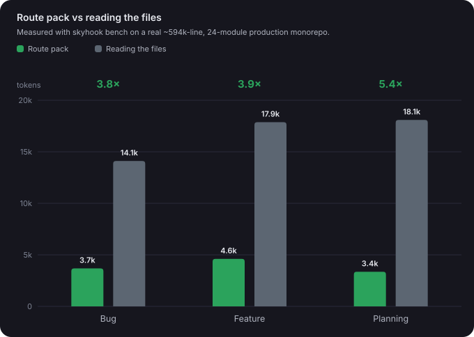
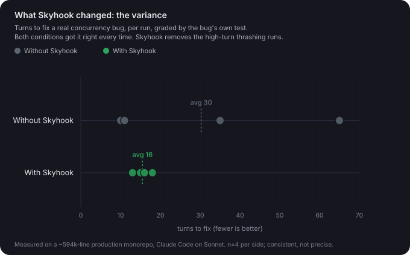

<p align="center">
  
</p>

# Skyhook

Skyhook builds a small, readable map of a repository — backed by a tree-sitter
**AST symbol + call graph** — and uses it to create task-specific route packs for
coding agents, answer structural queries (callers, callees, blast radius), and
serve those queries over MCP.

It is not a vector database or full semantic index. It is a fast wayfinding
layer backed with a structural graph. It helps agents know where to start reading, which docs and tests matter, which files an edit impacts, and what calls what. And it can do it without the
agent grep-exploring the repo.

A Skyhook route pack is a fraction of the size of reading the relevant files by hand (`skyhook bench` measures that ratio for your repo). For some tasks, Skyhook can reduce token usage by more than 25% and use about half the turns. This is achieved mostly by clamping the worst-case exploration without degrading the quality of the outputs.

## The Problem

Large repositories burn time and tokens before useful work starts. A new agent session often has to rediscover the same things:

- where the main entrypoints are
- which directories own which features or domains
- where architecture docs, ADRs, C4 diagrams, and design notes live
- which tests matter for a change
- which files are likely edit targets for a bug, review, or implementation task
- what local conventions are worth reading before touching code

Normal search helps after you know what to search for. A full index can help too, but it is heavier than many teams need and can still bury the starting point in too much detail. Skyhook is smaller than that. It produces a compact map that agents can read before they open a broad set of files.

## How Skyhook Solves It

`skyhook init` scans the repository and writes generated orientation artifacts under `.skyhook/`.

The important artifacts are:

- `.skyhook/INDEX.md`: short entrypoint for agents
- `.skyhook/map.md`: full generated overview
- `.skyhook/map.json`: canonical machine-readable map
- `.skyhook/docs.md`: documentation inventory
- `.skyhook/architecture.md`: architecture and design references
- `.skyhook/tests.md`: discovered tests and verification hints
- `.skyhook/areas/<area>.md`: focused notes for detected code areas
- `.skyhook/graph.json`: diffable export of the AST symbol + call graph (committed)
- `.skyhook/graph.db`: the SQLite graph queried by `skyhook graph` and `skyhook mcp` (regenerable; gitignored)
- `.skyhook/mcp.json`: ready-to-use MCP registration (with `alwaysLoad`) so a coding agent can call the graph tools (see `skyhook mcp`)

`skyhook init` builds the map **and** the graph in one pass. `skyhook graph
query` answers structural questions (`callers`, `callees`, `blast-radius`,
`exists`, `symbols-in-file`, `search`, `defs`); `skyhook mcp` serves the same as
read-only MCP tools for any agent/editor.

`skyhook route` takes a task, issue, review note, or bug report and builds a smaller route pack from the map. Route packs are shaped by profile:

- `product_planning`
- `requirements_planning`
- `technical_breakdown`
- `implementation`
- `code_review`
- `bug_hunt`

The route pack is the part an agent should read for a specific job. The map is the durable repo orientation.

## Why It Works This Way

Skyhook favors generated files over a service because agents and humans can inspect the output, commit it if they want, diff it in review, and use it on local machines or CI runners without extra infrastructure.

The map is navigational, good enough to point to the right code and docs
quickly. The **AST graph** underneath it adds the precise layer: real symbols
(functions, classes, methods with scope), imports, member calls with their
receivers, and package declarations, parsed with tree-sitter (Python, Swift,
Kotlin, Java, JavaScript, TypeScript, Go, Elixir). Calls resolve through a
staged ladder (same file, qualifier (`Foo.bar()` resolves to `bar` inside
`Foo`), imports, same package, then a repo-wide name match as the last resort)
and every edge carries its `resolution` grade, so consumers can tell a
scope-resolved binding from a heuristic guess instead of treating everything as
approximate. The graph is what lets `skyhook route` embed call chains and blast
radius so agents stop guessing about what a change touches.

Model usage is optional. With an OpenAI-compatible provider, Skyhook can produce better summaries. Without a key, static mode still produces deterministic output from filenames, docs, symbols, imports, tests, and repository structure.

## Benchmarks

Both charts come from a real ~594k-line, 24-module production monorepo.

`skyhook bench` measures the artifact: a task-scoped route pack is a fraction
of the tokens an agent would read to orient by hand.



What that buys a real agent is more modest. On a real, non-obvious concurrency
bug, graded by the bug's own test, Skyhook did not change correctness; both
conditions fixed it every run. It changed the variance. Baseline runs scattered
from 10 to 65 turns, and with Skyhook they clustered between 13 and 18, which
works out to roughly a quarter to a third cheaper on average.



Four runs per side, Claude Code on Sonnet, so treat it as consistent rather
than precise. The full methodology and caveats are in
[docs/benchmarking.md](docs/benchmarking.md).

## Agent Setup

This setup is meant to be done by a coding agent. Paste this prompt into
Claude Code or Codex running in the repository you want mapped and review
what it reports back:

```text
Set up Skyhook in this repository so agent sessions start from a task-scoped
route pack and structural queries instead of grep-exploring the repo.

Done means `.skyhook/INDEX.md` exists, `skyhook check` passes, `skyhook route
--task "<a real task for this repo>"` names files that exist, and the skyhook
MCP tools show up in the agent's toolset after a session restart.

Work from the README at https://github.com/KalebKE/Skyhook and `skyhook --help`:

1. Install it: `python3 -m pip install "skyhook-graph[mcp]"` (the MCP extra
   needs Python >= 3.10).
2. Run `skyhook init --provider static` from the repository root. Static mode
   is deterministic and sends nothing to a model. Only use `--provider openai`
   if an API key is already configured and the user approves.
3. In a monorepo, add include/exclude entries to `.skyhook/config.yaml` so the
   scan stays focused, then rerun `skyhook init`.
4. Run `skyhook wire --dry-run`, show the user what it would change, then run
   `skyhook wire`. Keep `alwaysLoad: true` in the MCP entry. Without it the
   server connects after the session starts and the tools never appear.
5. Verify with observable state: `skyhook check` exits 0, `skyhook route`
   points at real files, and `skyhook graph query callers <a symbol you know>`
   matches what the code says.

Constraints: do not commit `.skyhook/` unless the repository already commits
generated artifacts or the user asks for it. Do not send source to a model
provider without approval. Flag any write outside the repository before making
it (the Codex wire entry lands in the global ~/.codex/config.toml). Finish
with a short summary of what was installed, what wire changed, and the
verification output.
```

The sections below cover the same setup by hand.

## Install

From PyPI (the distribution name is `skyhook-graph`; the command is `skyhook`):

```sh
python3 -m pip install "skyhook-graph[mcp]"
```

From a checkout:

```sh
python3 -m pip install -e .
```

From another repository or a remote runner:

```sh
python3 -m pip install "git+https://github.com/KalebKE/Skyhook.git"
```

Run without installing:

```sh
python3 -m skyhook --help
```

## First Run

From the repository you want to map:

```sh
skyhook init
```

Use deterministic offline mode:

```sh
skyhook init --provider static
```

Use a model when an API key is available:

```sh
OPENAI_API_KEY=... skyhook init --provider openai
```

After this, point agents at `.skyhook/INDEX.md` first. For task-specific work, use `skyhook route`.

## Wire It Into Your Agent

Connecting the tools is not enough on its own. The agent also has to be told
to reach for them, in context it will read, or it falls back to grep.
`skyhook wire` does both. It registers the MCP server and writes the
query-first protocol into your agent's always-on context. It detects Claude
Code, Codex, and Cursor, shows exactly what it will change, and asks before
writing:

```sh
skyhook wire                        # detect agents, confirm, write (project scope)
skyhook wire --dry-run              # preview only, write nothing
skyhook wire --agent cursor --yes   # one agent, no prompt
```

Writes are idempotent (re-run to update) and never touch content outside their own markers:

- **Claude Code**: `skyhook` in the repo's `.mcp.json` (with `alwaysLoad`) + a marked block in `CLAUDE.md`.
- **Cursor**: `skyhook` in `.cursor/mcp.json` + a `.cursor/rules/skyhook.mdc` rule.
- **Codex**: a per-repo `[mcp_servers.skyhook-<repo>]` in the global `~/.codex/config.toml` (the one global write, flagged before it happens) + a marked block in the repo's `AGENTS.md`.

Restart your agent session afterward so it picks up the new config.

## Configuration

Optional config lives at `.skyhook/config.yaml`.

```yaml
version: 1
outputDir: .skyhook
model:
  provider: auto
  model: auto
  timeoutSeconds: 90
  maxPromptBytes: 96000
scan:
  include:
    - .
  exclude:
    - build
    - dist
    - node_modules
    - .git
    - .gradle
    - .sim-worktrees
  maxFiles: 5000
docs:
  extraGlobs:
    - "docs/**/*.md"
    - "adr/**/*.md"
    - "architecture/**/*.md"
    - "**/*ADR*.md"
    - "**/*C4*.md"
```

The YAML parser supports a small subset. Skyhook does not require PyYAML.

Use `include` to keep the scan focused in monorepos. Use `exclude` for generated output, dependency directories, build artifacts, and large local worktrees.

## Model Provider

Skyhook supports an OpenAI-compatible chat completions endpoint through the Python standard library.

Skyhook reads these environment variables:

- `OPENAI_API_KEY` or `SKYHOOK_API_KEY`
- `OPENAI_BASE_URL` or `SKYHOOK_BASE_URL`
- `SKYHOOK_MODEL`
- `SKYHOOK_TIMEOUT_SECONDS`
- `SKYHOOK_MAX_PROMPT_BYTES`

The default model is `gpt-4.1-mini`.

Model-backed map generation keeps each request below `maxPromptBytes` by
analyzing large scans in stable path-ordered chunks and reducing the partial
results into one map. The 96,000-byte default is safe for 128k-context models;
lower it for an OpenAI-compatible model with a smaller context window.

If no API key is available and provider is `auto`, Skyhook uses static mode.

Tools built on Skyhook can reuse the same provider plumbing through the public
helper `skyhook.model.chat_json(config, messages, provider_override=None)`.
It returns a parsed JSON object, or `None` when the resolved provider is
static so callers can fall back to deterministic behavior. Provider resolution
is exposed as `skyhook.model.resolve_provider(config, provider_override=None)`.

## Commands

### `skyhook init`

Generate or refresh the map:

```sh
skyhook init
```

Preview whether output would change:

```sh
skyhook init --provider static --dry-run
```

### `skyhook route`

Route a task through the map:

```sh
skyhook route --task "add retry handling to sync failures"
```

Use a task file:

```sh
skyhook route --profile implementation --task-file issue.md
```

Use a profile that matches the work:

```sh
skyhook route --profile technical_breakdown --task-file issue.md
skyhook route --profile code_review --task-file pr-notes.md
skyhook route --profile bug_hunt --task "diagnose empty dashboard cards"
```

Emit JSON for a harness:

```sh
skyhook route --task-file issue.md --format json
```

Persist the route under `.skyhook/routes/`:

```sh
skyhook route --task-file issue.md --save
```

### `skyhook graph`

Build and query the AST symbol + call graph. `skyhook init` builds it
automatically; `skyhook graph build` rebuilds it on its own (incremental by
default, `--full` to rebuild from scratch).

```sh
skyhook graph build
skyhook graph query callers BillingService          # who calls it
skyhook graph query callees BillingService          # what it calls
skyhook graph query blast-radius src/billing.py      # what an edit impacts
skyhook graph query exists src/billing.py            # does this path exist?
skyhook graph query symbols-in-file src/billing.py
skyhook graph query search Billing
skyhook graph stats
```

Add `--json` for a harness. Every call edge carries a `resolution` grade
(`same_file`/`qualified`/`imported`/`same_package` are precise; `global` and
`candidate` are heuristic and keep the `approximate` flag). `skyhook graph
stats` breaks resolution down by stage.

### `skyhook mcp`

Serve the graph as read-only MCP tools for any MCP client. Requires the `mcp`
extra (`pip install 'skyhook-graph[mcp]'`, Python >= 3.10).

- `route`: turns a task into an orientation pack (where to start, likely edit
  targets, tests, call chains, blast radius). Call this **first** for a coding
  task, instead of grepping to find where to work.
- `find_symbol`, `search`, `symbols_in_file`: locate definitions.
- `callers_of`, `callees_of`, `blast_radius`: trace structure and impact.
- `file_exists`, `graph_stats`: coverage checks.

```sh
skyhook mcp --repo .
```

`skyhook init` writes a ready-to-use registration to `.skyhook/mcp.json`. Point
your client at it (Claude Code: `claude --mcp-config .skyhook/mcp.json`):

```json
{ "mcpServers": { "skyhook": { "command": "skyhook", "args": ["mcp", "--repo", "/abs/path/to/repo"], "alwaysLoad": true } } }
```

**Keep `alwaysLoad: true`.** It is not cosmetic: without it, clients start the
session before the stdio server finishes connecting, so Skyhook's tools never
enter the agent's toolset. The server stays `pending` and the agent silently
falls back to grep. With it, the client waits for the connection and every tool
is present from the first turn.

### `skyhook bench`

Estimate the context reduction of a graph route pack versus reading the files an
agent would otherwise open:

```sh
skyhook bench --task "fix retry handling in BillingService"
```

This measures the *artifact* (how much smaller the pack is than the files it
points at) and assumes the agent uses the pack instead of grep-exploring. It is
not a measurement of agent behavior. For that, and for what Skyhook does and
does not change (efficiency and consistency, not correctness or a headline
token multiplier), see [docs/benchmarking.md](docs/benchmarking.md).

### `skyhook check`

Use this when `.skyhook/` artifacts are committed and you want CI to catch stale
maps **and** stale graphs (`graph.json`):

```sh
skyhook check
```

`check` fails when `.skyhook/map.json` does not match the current repository scan digest.

## When To Rerun

Run `skyhook init`:

- when adding Skyhook to a repository
- after large directory moves or module splits
- after adding or removing major entrypoints
- after changing important architecture, ADR, design, or testing docs
- before handing a stale repository to a new agent session
- before opening a PR if `.skyhook/` artifacts are part of the repo contract

Run `skyhook route` for each meaningful task. A route is task-specific and should not be treated as a permanent repo map.

Run `skyhook check` in CI only if you commit `.skyhook/` artifacts and want freshness enforced.

## CI Example

This example assumes the repository commits `.skyhook/` artifacts and wants pull requests to fail when the map is stale.

```yaml
name: skyhook

on:
  pull_request:

jobs:
  check-map:
    runs-on: ubuntu-latest
    steps:
      - uses: actions/checkout@v4
      - uses: actions/setup-python@v5
        with:
          python-version: "3.11"
      - run: python3 -m pip install "git+https://github.com/KalebKE/Skyhook.git"
      - run: skyhook check
```

## Development

```sh
python3 -m unittest
python3 -m skyhook init --provider static --dry-run
python3 -m skyhook route --profile implementation --task "add retry handling to sync failures"
```
